# Comparing small local LLMs — what the notebook does

[`compare_llms.ipynb`](compare_llms.ipynb) runs small open models on this laptop through **Ollama**, sends them identical prompts, and logs the outputs, latency and token counts. It's organized as five experiments, each teaching one foundation-model concept: **inference**, **sampling**, **quantization**, and **model size vs. quality**.

> **Charts in this file.** The PNG charts in [`assets/`](assets/) come from the real run log in [`runs/`](runs/), except where a caption says *illustration*. To refresh them after more runs, run `python make_readme_figs.py` with the `glm_test` venv.
> The flow diagrams are Mermaid. GitHub renders them as is. In VS Code, install the **Markdown Preview Mermaid Support** extension (`bierner.markdown-mermaid`) to see them in the preview.

---

## 1. Architecture

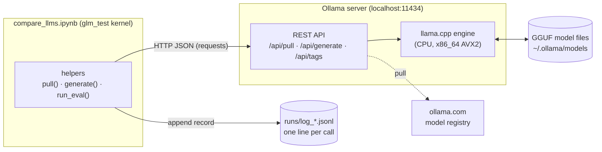

* The **notebook** never loads model weights itself. It sends HTTP requests, which makes the measurements easy to read.
* The **Ollama server** keeps a model in RAM for 10 minutes after use (`keep_alive`). Only the first call pays the load cost.
* Every `generate()` call appends one JSON record to `runs/`, so results survive kernel restarts.

---

## 2. Roadmap

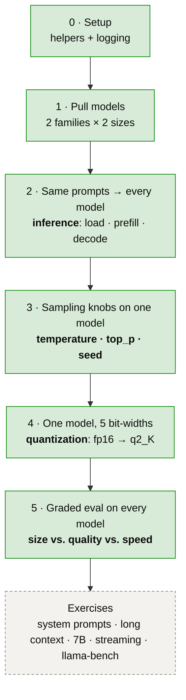

| Part | Status (as of the last chart refresh) | Calls logged |
|---|---|---|
| 0 · Setup | ✅ run | — |
| 1 · Pull models | ✅ 4 models downloaded | — |
| 2 · Same prompts, every model | ✅ run | 24 |
| 3 · Sampling | ✅ run (3a–3d) | 144 |
| 4 · Quantization | ✅ run (5 levels) | 111 |
| 5 · Size vs. quality | ✅ run | 60 |

---

## 3. Part 1: the models

Two families at two sizes each. Comparing within a family isolates the effect of size; comparing across families at similar size shows that training data and tokenizer matter too.

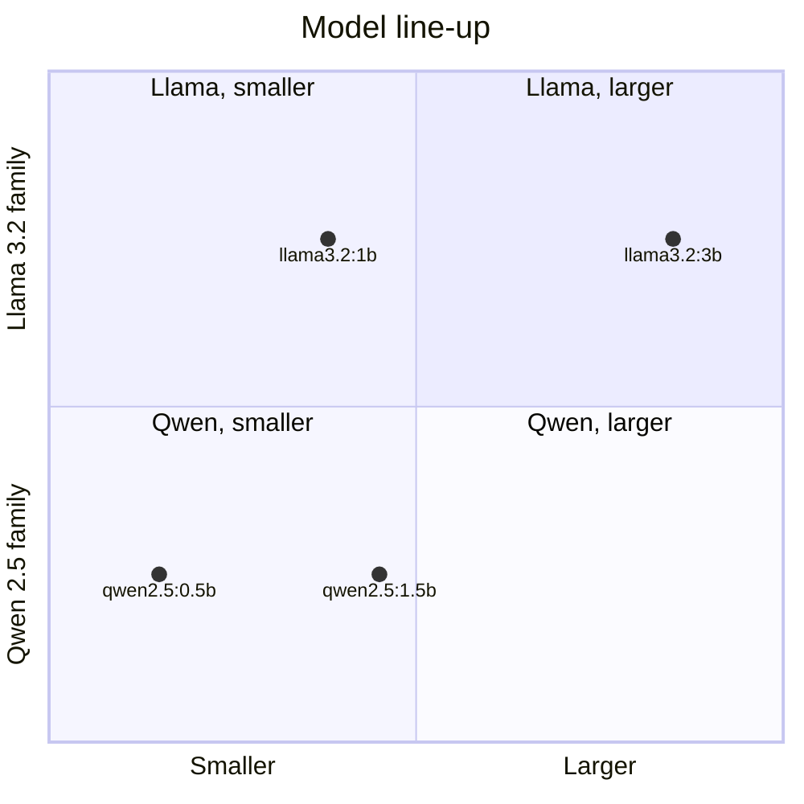

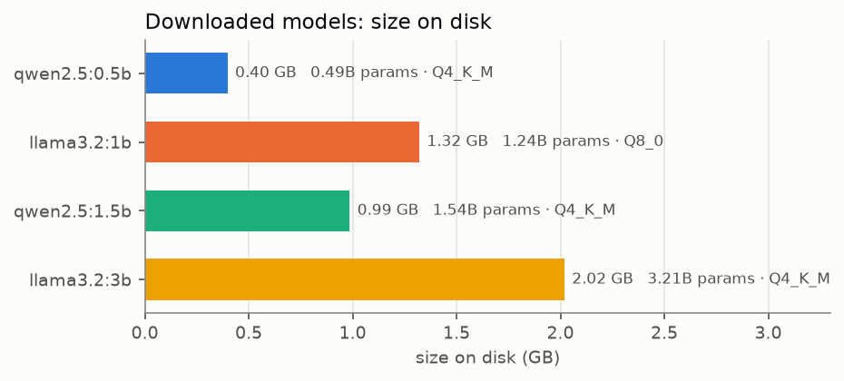

**Size on disk ≈ parameters × bits per weight ÷ 8.** One surprise: `llama3.2:1b` defaults to **8-bit (Q8_0)**, while the other three default to 4-bit (Q4_K_M). That's why it's larger on disk than the 1.5B Qwen even though it has fewer parameters.

---

## 4. Part 2: inference, one prompt at a time

The same six prompts (explain, reasoning, code, JSON, haiku, trick question) go to every model at `temperature = 0`, so the outputs are repeatable.

### What happens inside one `generate()` call

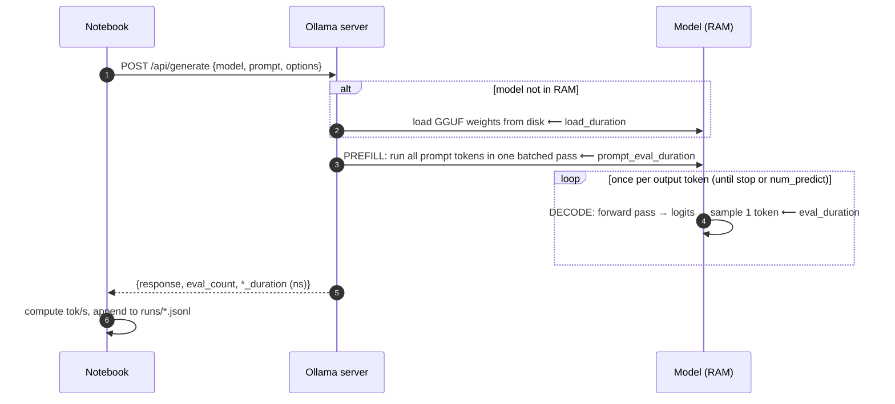

### Measured: decode is where the time goes

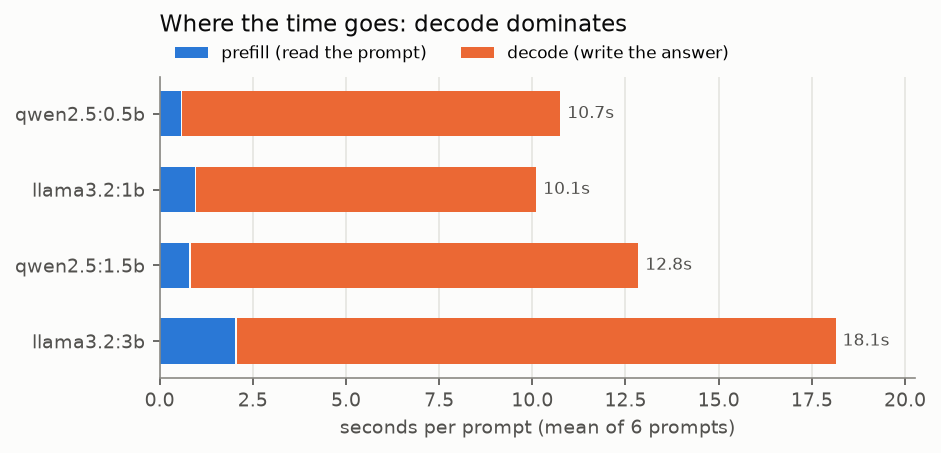

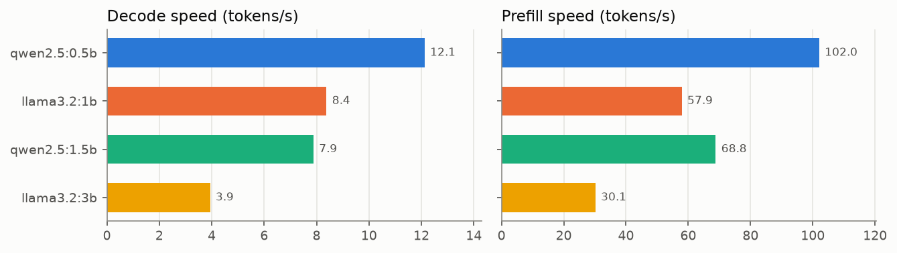

| Takeaway | Evidence from your run |
|---|---|
| **Prefill is ~8× faster per token than decode.** Prefill handles every prompt token in one parallel matrix multiply; decode needs a full pass over all the weights for *each* new token. | qwen2.5:0.5b: 102 tok/s prefill vs 12 tok/s decode |
| **Decode speed roughly tracks bytes of weights**, because on a CPU every output token has to read the whole model from RAM. | 0.40 GB → 12 tok/s · 2.02 GB → 4 tok/s |
| **Verbosity matters as much as speed.** The fastest model isn't the quickest to finish when it writes more tokens. | qwen2.5:0.5b hit the 256-token cap on the reasoning and code prompts (`done_reason = "length"`) |
| **Tokenizers differ.** The same prompt costs a different number of tokens per family. | Llama: 47 prompt tokens on average · Qwen: 52 |

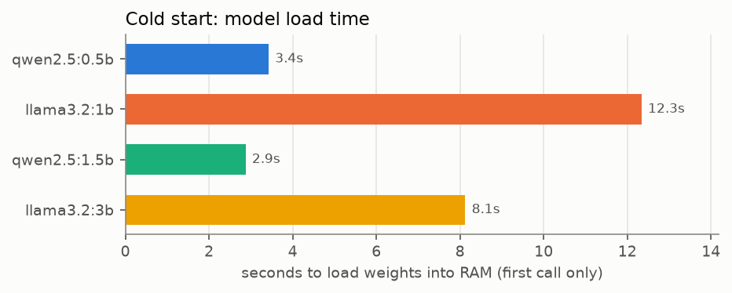

The first call to each model includes loading the weights from disk. These numbers depend heavily on whether the file was already in the OS disk cache, so treat them as rough.

### Quality at a glance (temperature 0)

| Prompt | qwen2.5:0.5b | llama3.2:1b | qwen2.5:1.5b | llama3.2:3b |
|---|---|---|---|---|
| Bat & ball ($0.05) | ✅ | ✅ | ✅ | ✅ |
| 5th word = "jumps" | ❌ "dog" | ✅ counted 1–5 | ❌ "quick" | ✅ counted 1–5 |
| JSON array only | ⚠️ fenced in ```` ```json ```` | ⚠️ fenced | ⚠️ fenced | ✅ bare JSON |

The Llama models counted step by step on the trick question unprompted and got it right. Both Qwen models answered straight away and got it wrong.

---

## 5. Part 3: sampling

At every decode step the model produces a **logit** for every token in its vocabulary (about 128k for Llama 3.2, about 152k for Qwen 2.5). **Sampling** turns those logits into one chosen token:

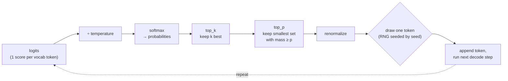

### Temperature reshapes the distribution *(illustration)*

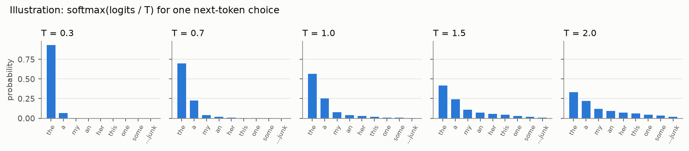

As `T → 0` the top token always wins (greedy decoding). `T = 1` leaves the model's distribution unchanged. `T > 1` flattens it, so the "…junk" tail starts getting picked.

### top_p removes the tail *(illustration)*

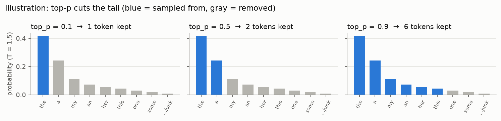

### 3a · Determinism: measured

| Setting | 3 runs → unique outputs | Why |
|---|---|---|
| `temperature = 0` | **1** | greedy: always takes the top token |
| `temperature = 1`, `seed = 7` | **1** | same seed gives the same random draws |
| `temperature = 1`, random seeds | **3** | genuine sampling |

### 3b / 3c · Temperature and top_p sweeps: measured

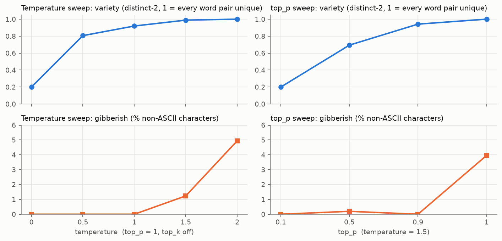

Samples from your run (`llama3.2:1b`, prompt: *"Write a one-sentence opening line for a mystery novel."*):

| Setting | Example output |
|---|---|
| T = 0 | *As I stepped into the musty attic of my family's old Victorian home, the creaking of the wooden floorboards…* (all 5 identical) |
| T = 1.0 | *In the sleepy coastal town of Ravenswood, where the mist rolled in like a living entity, Detective James Winte…* |
| T = 1.5 | *The small,吃dia Alright therapist Dr meticulously pierced closer.maxdling blamed rewrite ranking…* |
| T = 2.0 | *lc_entities fort Former BonddogsMouse finalize Troy"S uncovered alleg overlays cottage anew wikΆ…* |
| T = 1.5, top_p = 0.9 | *It was a chilly autumn evening when Dr. Emma Taylor received a mysterious phone call from a stranger…* |

**Key insight:** at T = 1.5, `top_p = 1.0` produces gibberish but `top_p = 0.9` stays fluent *and* varied. Cutting the 10% tail removes the junk tokens without collapsing diversity. That's why real deployments combine temperature with top_p / top_k.

### 3d · "Pick a random number": measured

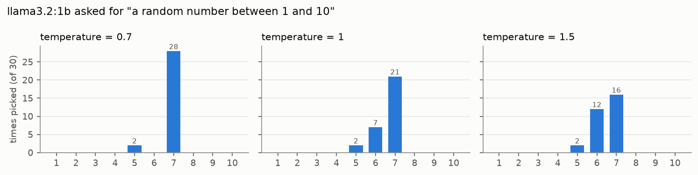

An LLM is a poor random number generator: it samples from *learned* preferences. At T = 0.7 it said **7** in 28 of 30 tries, matching the well-known human bias toward 7. Raising the temperature spreads the choice a little (toward 6), but it never reaches a uniform 1–10.

---

## 6. Part 4: quantization

The same `llama3.2:1b` weights stored at five precisions:

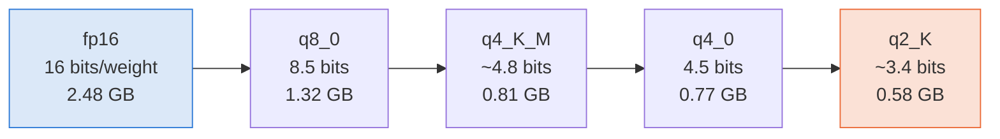

<sub>Left → right: smaller file, faster decode, more rounding error.</sub>

**How block quantization works (q8_0 / q4_0):** weights are grouped into blocks of 32. Each block stores one fp16 **scale** plus 32 small integers, and a weight is rebuilt as `w ≈ scale × int`. The "K-quants" (`_K_S`, `_K_M`) add a second level of scales and give more bits to sensitive layers.

What Part 4 measures for each level:

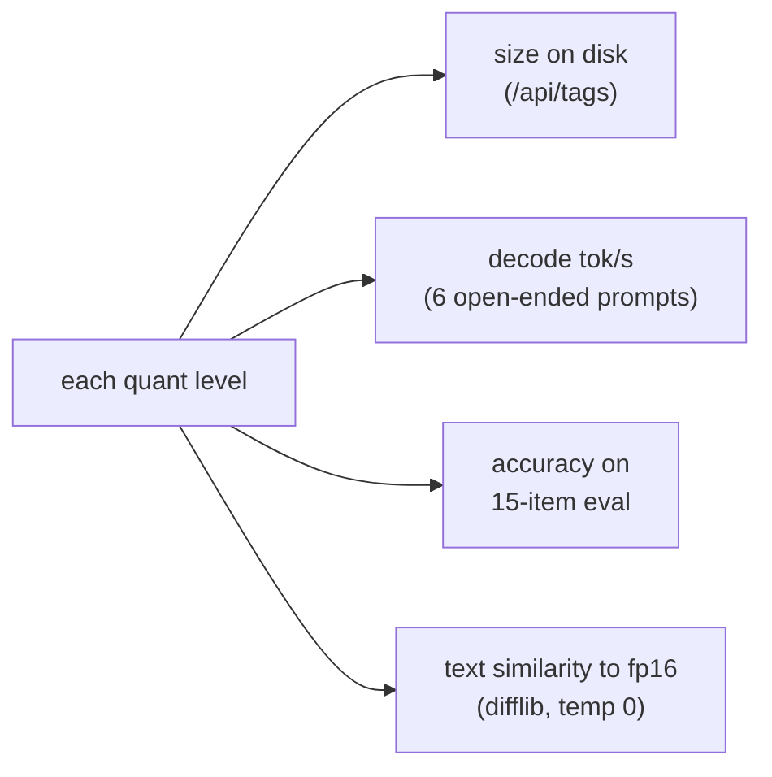

### Results: measured

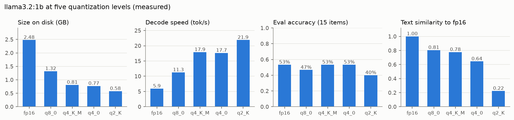

| Level | Size | Decode tok/s | vs. fp16 | Eval score | Similarity to fp16 |
|---|---|---|---|---|---|
| fp16 | 2.48 GB | 5.9 | 1.0× | 8 / 15 | 1.00 (reference) |
| q8_0 | 1.32 GB | 11.3 | 1.9× | 7 / 15 | 0.81 |
| q4_K_M | 0.81 GB | 17.9 | **3.0×** | 8 / 15 | 0.78 |
| q4_0 | 0.77 GB | 17.7 | 3.0× | 8 / 15 | 0.64 |
| q2_K | 0.58 GB | 21.9 | 3.7× | 6 / 15 | **0.22** |

**What the numbers show:**

1. **Speed follows file size.** Halving the bytes (fp16 → q8_0) nearly doubled decode speed (5.9 → 11.3 tok/s). That's the memory-bandwidth limit from Part 2 again: each token has to read every weight, so fewer bytes means faster tokens.
2. **The eval score barely moves until q2_K.** 8 → 7 → 8 → 8 → 6 is within noise for 15 questions (one question = 7 points). Only q2_K is clearly worse.
3. **Text similarity is the more sensitive signal.** Greedy outputs drift further from fp16 at every step down, and q2_K's answers are almost entirely different text (0.22).
4. **K-quants are worth it.** q4_K_M and q4_0 are the same size and speed, but q4_K_M stays much closer to fp16 (0.78 vs 0.64). That's why `q4_K_M` is Ollama's default.

**Sweet spot: `q4_K_M`.** It's 3× smaller and 3× faster than fp16, with the same eval score.

### Watching quantization break an answer

The train question (*3:40 PM + 2 h 35 min*) shows the errors creeping in, all at temperature 0:

| Level | Model's working | Result |
|---|---|---|
| fp16 / q8_0 | 3:40 PM + 2 hours = 5:40 PM → + 35 minutes = **6:15 PM** | ✅ |
| q4_K_M | 3:40 PM + 2 hours = **6:40 PM** … | ❌ wrong hour |
| q4_0 | 5:40 PM + 35 minutes = **5:75 PM** | ❌ forgot to carry the hour |
| q2_K | "Train leaves at 3:40 PM" = "Train travels for 2 hours and 35 minutes" … | ❌ lost the thread |

Reversing "planet" (answer `tenalp`) shows the same pattern: fp16, q8_0 and q4_K_M all say `netalp`, q4_0 says `tnalep`, and q2_K says `elpidat`.

Quantization noise can also flip an answer **the right way**: q4_0 was the only level to answer "same" on feathers vs. steel. Small differences between levels are mostly noise, not a ranking.

### Per-item results

| Item | fp16 | q8_0 | q4_K_M | q4_0 | q2_K |
|---|---|---|---|---|---|
| `arith_mul` | · | · | ✅ | ✅ | · |
| `arith_pct` | · | · | · | · | · |
| `primes` | · | · | · | · | · |
| `capital` | ✅ | ✅ | ✅ | ✅ | ✅ |
| `gold` | ✅ | ✅ | ✅ | ✅ | ✅ |
| `author` | ✅ | ✅ | ✅ | ✅ | ✅ |
| `spanish` | ✅ | ✅ | ✅ | ✅ | ✅ |
| `letters` | ✅ | · | ✅ | · | · |
| `reverse` | · | · | · | · | · |
| `sort` | ✅ | ✅ | ✅ | ✅ | ✅ |
| `feathers` | · | · | · | ✅ | · |
| `sisters` | · | · | · | · | · |
| `time` | ✅ | ✅ | · | · | · |
| `bat_ball` | · | · | · | · | · |
| `json` | ✅ | ✅ | ✅ | ✅ | ✅ |
| **Score** | **8 / 15** | **7 / 15** | **8 / 15** | **8 / 15** | **6 / 15** |

The q8_0 column matches the plain `llama3.2:1b` results in Part 5 exactly. They're the same file and decoding is greedy, so the run is reproducible.

---

## 7. Part 5: model size vs. quality

Each model answers 15 questions that have a single, checkable answer:

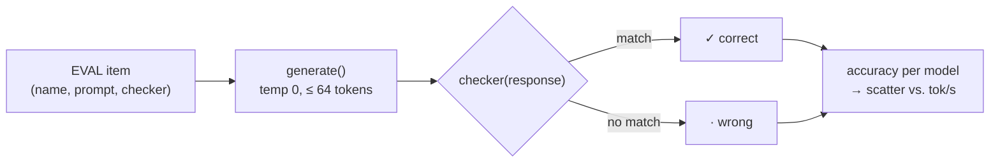

| Category | Items | Checker |
|---|---|---|
| Arithmetic | `17 × 24`, `15% of 80`, primes < 20 | first number in reply equals answer |
| Facts | capital of Australia, symbol for gold, author of *Pride and Prejudice*, Spanish for "thank you" | case-insensitive regex |
| Character-level | r's in "strawberry", reverse "planet", alphabetical sort | regex |
| Reasoning | feathers vs. steel, Sally's sisters, train arrival time, bat & ball | number / regex |
| Format | JSON object `{name, age}` | `json.loads` and check the fields |

### Results: measured

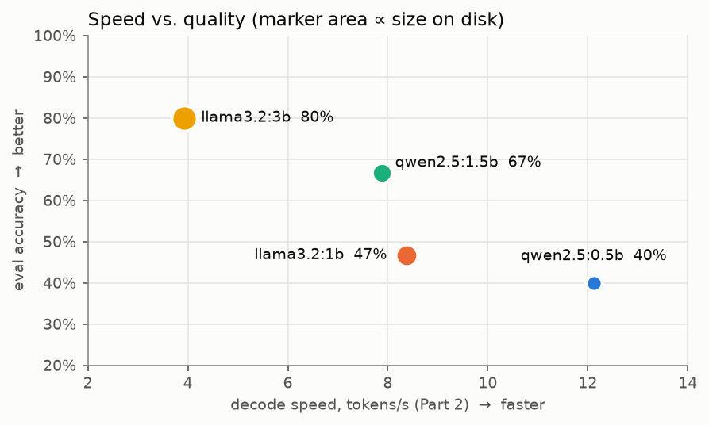

<sub>Speed is from Part 2, where answers were long. Part 5 answers average about 9 tokens, which makes its logged tok/s look roughly twice as high, so it isn't a fair speed benchmark.</sub>

| Model | Params | Size | Decode tok/s | Score |
|---|---|---|---|---|
| qwen2.5:0.5b | 0.49B | 0.40 GB | 12.1 | 6 / 15 (40%) |
| llama3.2:1b | 1.24B | 1.32 GB (Q8) | 8.4 | 7 / 15 (47%) |
| qwen2.5:1.5b | 1.54B | 0.99 GB | 7.9 | 10 / 15 (67%) |
| llama3.2:3b | 3.21B | 2.02 GB | 3.9 | **12 / 15 (80%)** |

**What the numbers show:**

1. **Size pays off within a family.** Qwen 0.5B → 1.5B gained 4 questions; Llama 1B → 3B gained 5. Each step up cost about 35–55% of the decode speed.
2. **Family matters at similar size.** `qwen2.5:1.5b` beat `llama3.2:1b` by 3 questions at about the same speed and with a smaller file (4-bit vs. 8-bit). On this eval it's the best value. (It did fail the "5th word" trick in Part 2, which the Llama models got right.)
3. **Facts are easy; multi-step reasoning is what grows with size.** Every model knew gold, Austen, *gracias*, sorting and JSON. Only `llama3.2:3b` solved bat & ball and feathers vs. steel.
4. **Hypothesis check on character-level items:** mostly confirmed. "Count the r's" and "reverse planet" were each solved by only one of four models, and the right answers look like luck rather than ability. The fp16 version of `llama3.2:1b` counted 3 r's, but its q8_0 copy said 4.
5. **One question beat every model:** *"Sally has 3 brothers, each brother has 2 sisters. How many sisters does Sally have?"* (answer: 1). The models said 2, 3 or 4, because they count Sally or multiply brothers by sisters.

### Per-item results

| Item | qwen2.5:0.5b | llama3.2:1b | qwen2.5:1.5b | llama3.2:3b |
|---|---|---|---|---|
| `arith_mul` | · | · | ✅ | ✅ |
| `arith_pct` | ✅ | · | ✅ | ✅ |
| `primes` | · | · | ✅ | · |
| `capital` | · | ✅ | ✅ | ✅ |
| `gold` | ✅ | ✅ | ✅ | ✅ |
| `author` | ✅ | ✅ | ✅ | ✅ |
| `spanish` | ✅ | ✅ | ✅ | ✅ |
| `letters` | · | · | ✅ | · |
| `reverse` | · | · | · | ✅ |
| `sort` | ✅ | ✅ | ✅ | ✅ |
| `feathers` | · | · | · | ✅ |
| `sisters` | · | · | · | · |
| `time` | · | ✅ | · | ✅ |
| `bat_ball` | · | · | · | ✅ |
| `json` | ✅ | ✅ | ✅ | ✅ |
| **Score** | **6 / 15** | **7 / 15** | **10 / 15** | **12 / 15** |

**Grading caveat:** the train-time item needs more than the 64-token answer limit for some models. Llama states `6:15 PM` mid-working before the cutoff; the Qwen models were still setting up when they hit the limit. So that item partly measures wordiness. To fix it, raise `num_predict` in `run_eval` or add "answer only" to the prompt.

---

## 8. What gets logged

Every call appends one line to `runs/log_<timestamp>.jsonl`:

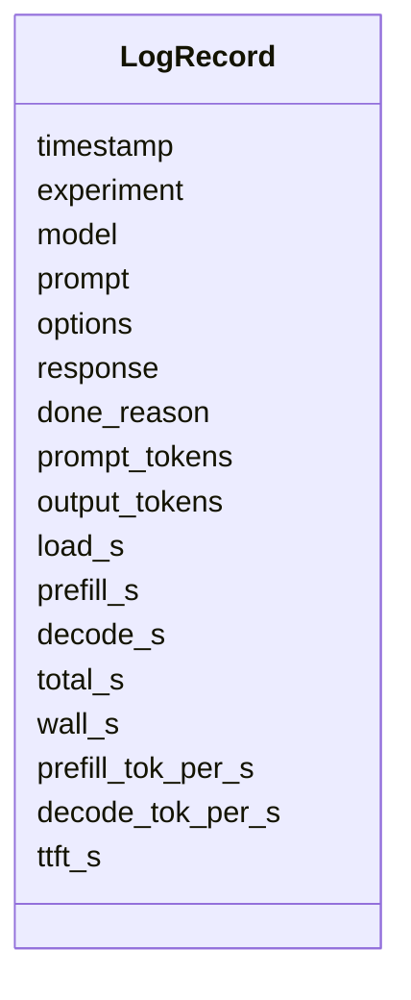

* `experiment` is one of `compare`, `determinism`, `temp_sweep`, `top_p_sweep`, `random_number`, `quant_eval`, `quant_drift`, `size_eval`, `warmup`.
* `options` holds the sampling settings sent with the call: `temperature`, `top_p`, `top_k`, `seed`, `num_predict`.
* `done_reason` is `stop` (finished naturally) or `length` (hit `num_predict`).

To reload everything across sessions:

```python
all_runs = pd.concat([pd.read_json(f, lines=True) for f in sorted(Path("runs").glob("*.jsonl"))])
```

---

## 9. Glossary

| Term | Meaning |
|---|---|
| **Token** | A chunk of text (word piece) — the unit the model reads and writes. |
| **Prefill** | Processing the whole prompt in one parallel pass; sets time-to-first-token. |
| **Decode** | Generating output one token per forward pass; memory-bandwidth bound. |
| **Logits** | Raw scores for every vocabulary token before softmax. |
| **Temperature** | Divides logits before softmax; low = sharp/deterministic, high = flat/random. |
| **top_p (nucleus)** | Sample only from the smallest token set whose probability sums to *p*. |
| **top_k** | Sample only from the *k* most likely tokens (Ollama default 40; notebook sets 0 = off). |
| **Seed** | Fixes the random draws → reproducible sampling. |
| **GGUF** | llama.cpp's single-file model format (weights + tokenizer + metadata). |
| **Quantization** | Storing weights in fewer bits (fp16 → 8 → 4 → 2) to cut size and speed up decode. |
| **K-quant** | llama.cpp quantization scheme with two-level scales and mixed precision per layer. |

---

## Files

```
compare_llms/
├── compare_llms.ipynb     # the experiments
├── README.md              # this guide
├── make_readme_figs.py    # rebuilds assets/*.png from runs/
├── assets/                # charts used above
└── runs/                  # JSONL log of every model call
```
